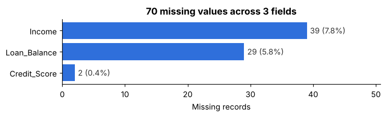
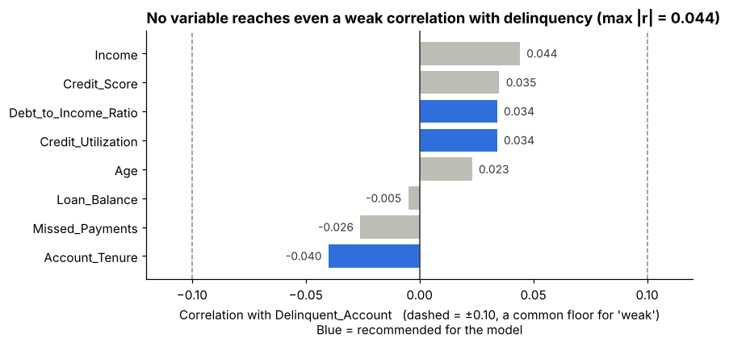
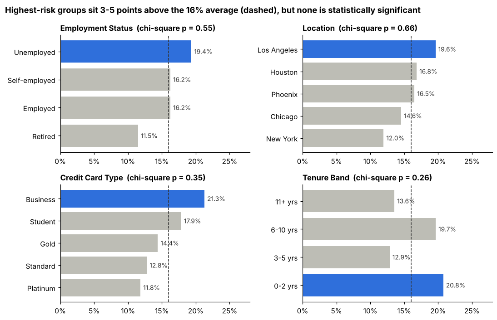

# Geldium Delinquency Risk: GenAI-Assisted Exploratory Data Analysis

**Tata GenAI-Powered Data Analytics Job Simulation (Forage) · Task 1**
Lexi Loughlin · M.S. Business Analytics, SMU Cox

## The business problem

Geldium, a financial services firm, wants to predict which credit card customers will become delinquent so its collections team can step in early. Before a model can be built, the data has to be trustworthy and the real risk signals have to be separated from noise. This project audits a 500-customer dataset, cleans it, and tests which variables actually predict delinquency.

## Key findings

**1. The data is easy to clean, but two of its fields contradict each other.**
Only 70 of 9,500 cells are missing (Income 39, Loan_Balance 29, Credit_Score 2), and Employment_Status needed six spellings merged into four categories. The bigger problem: `Missed_Payments` disagrees with the month-by-month payment history for **428 of 500 customers (86%)**, so at least one payment field can't be trusted.



**2. No variable reaches even a weak correlation with delinquency.**
Every correlation is below 0.05. Missed payments, income and credit score all point the *wrong* way: delinquent customers missed slightly fewer payments, earned more and had higher scores.



**3. Some segments run 3 to 5 points above the 16% average, but none is statistically significant.**
Business card holders (21.3%), new accounts (20.8%), Los Angeles (19.6%) and unemployed customers (19.4%) are the leads worth testing in a model.



**4. A leak-free baseline model confirms the weak signal.**
Logistic regression with SMOTE applied *inside* each training fold scores a cross-validated AUC of **0.49**, the same as random guessing. The recommendation is to fix the payment data and engineer combined features before tuning models.

## Recommended features for Task 2

| Variable | Why |
|---|---|
| Credit_Utilization | Standard credit-stress signal; slightly higher among delinquent customers (50.7% vs 48.9%) |
| Debt_to_Income_Ratio | Less income left after debt payments (0.306 vs 0.297) |
| Account_Tenure | Strongest single correlation (−0.040); accounts open 0–2 years run 20.8% delinquent |

## Methods

- **Missing data:** income imputed with the median of each employment group; loan balance and credit score with the overall median. All 500 records were kept.
- **Feature engineering:** over-limit flag, late/missed/on-time counts from the six-month history, a consistency score and a recent-deterioration flag.
- **Testing:** Pearson correlation and Mann-Whitney tests for numeric variables; chi-square tests for categorical segments.
- **Class imbalance (16% delinquent):** SMOTE is applied only to training folds, never to the full dataset, so synthetic rows can't leak into evaluation.
- **GenAI use:** GenAI was used to profile the data, suggest imputation methods and draft code. Every AI-generated claim was re-checked against the data. That check overturned its first ranking, which had named missed payments as the top predictor based on industry convention.

## Repository structure

```
├── data/
│   ├── Delinquency_prediction_dataset.xlsx   # original data (500 × 19)
│   └── Delinquency_cleaned.csv               # cleaned + engineered features (500 × 26)
├── notebooks/
│   └── 01_eda_and_preprocessing.ipynb        # full analysis with outputs
├── reports/figures/                          # charts used above
├── src/
│   └── data_preprocessing.py                 # reusable cleaning pipeline
└── requirements.txt
```

## Run it

```bash
pip install -r requirements.txt
python src/data_preprocessing.py        # writes data/Delinquency_cleaned.csv
jupyter notebook notebooks/01_eda_and_preprocessing.ipynb
```

**Tools:** Python (pandas, scipy, scikit-learn, imbalanced-learn, matplotlib), Jupyter, GenAI assistants
